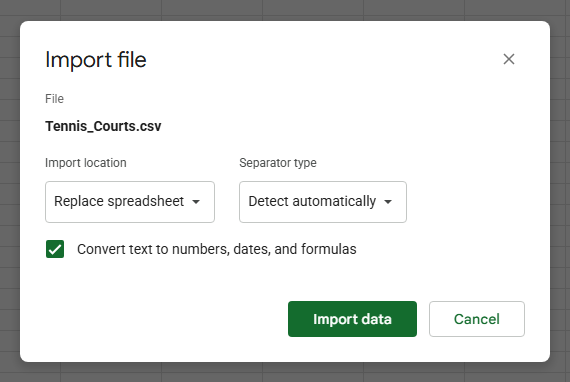
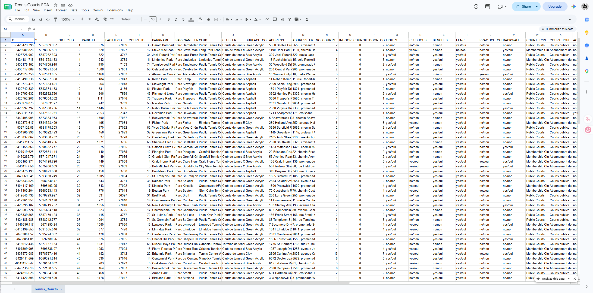
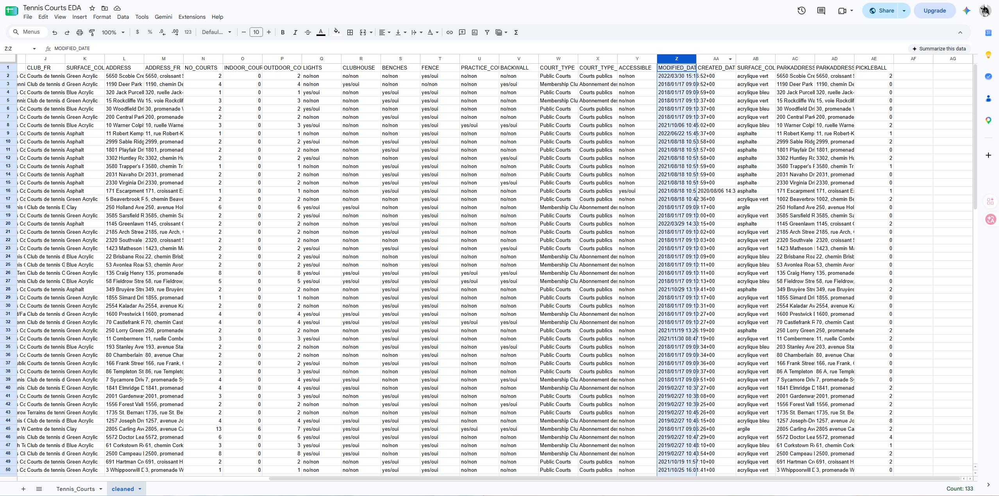
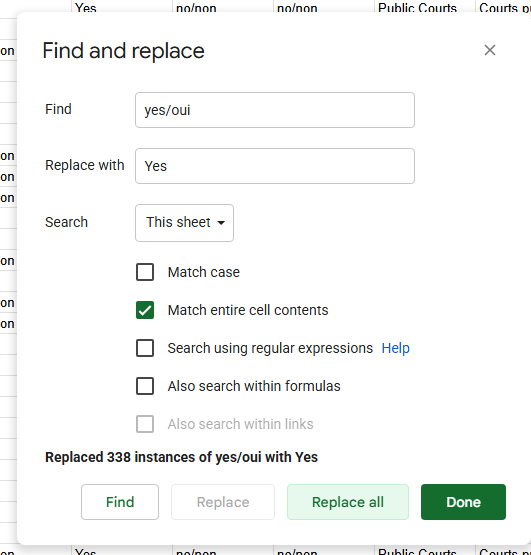
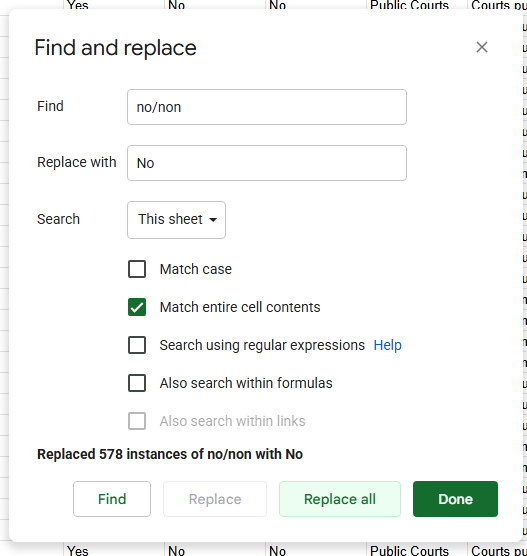
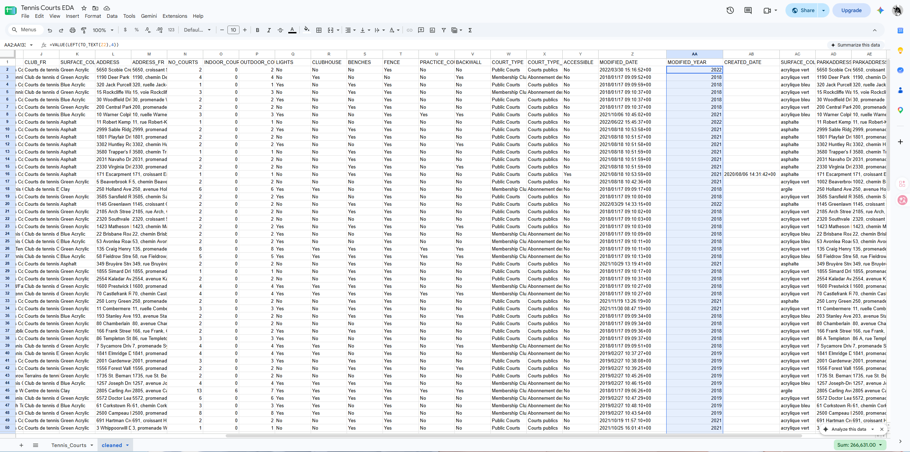
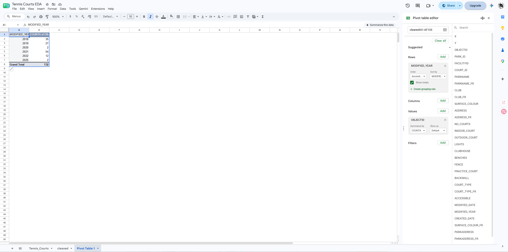
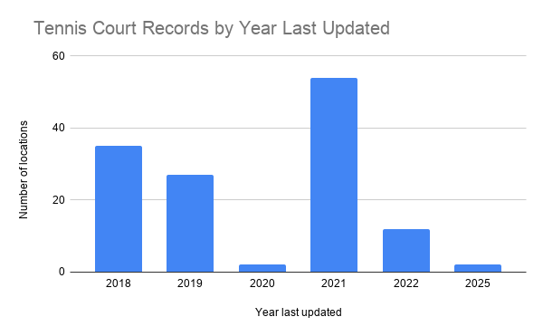

**Date** November 12, 2026<br>
**Course Code & Course Name** MPAD2003 Introductory Data Storytelling<br>
**Student's First Name & Last Name** Ruihua Liang<br>
**Presented to Jean-Sébastien Marier**<br>

# Deliverable 2: Exploratory Data Analysis (EDA)

## 1. Getting Data

The dataset is called Tennis Courts. It was published by the City of Ottawa (specifically maintained by its Parks Department) on the [Open Ottawa portal](https://open.ottawa.ca/datasets/dba3be479b2d44e2a90b28b522a6e39d_21) (City of Ottawa, 2024).

I downloaded the data from the Open Ottawa website. It is a CSV file named Tennis_Courts.csv. Then I created a new Google Sheets file, clicked File → Import → Upload, and chose this CSV file. In the pop-up window, I used the default settings (see Figure 1). Then I clicked "Import data" and renamed the spreadsheet "Tennis Courts EDA."

<br>
*Figure 1: The "Import file" prompt on Google Sheets.*

The dataset has 132 rows, with each row representing a tennis court location across Ottawa. It includes 38 columns that record details for each site, such as the park name, address, number of courts, whether it has lights, and the number of pickleball courts (`PICKLEBALL`) (see Figure 2).

<br>
*Figure 2: The Tennis Courts dataset after importing it into Google Sheets.*

* `PICKLEBALL` shows how many pickleball courts are at each location. 74 sites (about 56%) have a value greater than 0, and Centennial Park is still listed as having 4.
* `MODIFIED_DATE` records when each entry was last updated, with almost all dates falling between 2018 and 2022 (and only two in 2025). Centennial Park was last updated in 2019, suggesting some records may be outdated.
* `COURT_TYPE` categorizes the facility type, mainly into Public Courts and Membership Clubs, along with a few Private Clubs, School Board Sites, and a Practice Ball Wall.

I would like to use this dataset to map all 74 locations that have pickleball lines across Ottawa. By comparing their locations against the recommended residential buffer distances in the City's 2025 strategy (City of Ottawa, 2025), I want to find out whether Centennial Park is an isolated case or if other neighbourhoods are quietly facing similar noise pressures. I also want to check how outdated the City's records are, such as Centennial Park still being listed with four pickleball courts even though the City did not renew its outdoor pickleball permit.

The spreadsheet is available [here](https://docs.google.com/spreadsheets/d/18VVTWeDrgLcX1MwjUEdpvGhE-dj8CF8pdqz-fCnwe0M/edit?usp=sharing).

## 2. Understanding Data

### 2.1. VIMO Analysis

**Missing**

I used `=COUNTBLANK(AL2:AL133)` to do a quick missing value check. I found only 1 blank cell in the `PICKLEBALL` column (at Patrick Dugas Park).

The `OPEN` and `LINK`-related columns are almost completely empty, with 131 to 132 missing values out of 132 rows.

Also, the row for Mancini Park is missing several facility details, including lights, clubhouse, benches, fence, practice court, and backwall.

**Outliers**

Most places only have 1 to 4 tennis courts, but Britannia Park has 13 courts (including 6 indoor courts). Also, most places with pickleball only have 1 to 4 pickleball courts, but Pierre Rocque Park has 8.

**Invalid**

Columns such as `LIGHTS`, `FENCE`, and `BENCHES` use bilingual values ("yes/oui" and "no/non") instead of simple "Yes" or "No." This bilingual format makes counting and analyzing harder, so I need to standardize them before doing further analysis.

**Valid**

Key columns like `ADDRESS`, `COURT_TYPE`, and `NO_COURTS` are filled in for every row and follow a normal format. Also, the number columns for court counts (such as `NO_COURTS` and `PICKLEBALL`) contain only numbers with no text mixed in, so they are ready to use directly (apart from the one blank cell in `PICKLEBALL`).

### 2.2. Cleaning Data

Before cleaning, I duplicated the original sheet and named the copy "cleaned," so the raw data stays unchanged.

**Method 1: Removing empty columns**

I removed 7 columns (`OPEN`, `LINK`, `LINK_FR`, `LINK_LABEL`, `LINK_LABEL_FR`, `LINK_DESCRIPTION`, and `LINK_DESCRIPTION_FR`) because they were almost completely empty and provided no useful information for my analysis. By deleting them, the dataset went from 38 columns down to 31 columns, making it much easier to read.

<br>
*Figure 3: The dataset after removing the empty columns.*

**Method 2: Standardizing bilingual values**

Several columns used bilingual text for simple answers. I used the "Find and replace" tool, with "Match entire cell contents" checked so that only exact matches would be changed, to change 338 instances of "yes/oui" to "Yes" and 578 instances of "no/non" to "No." This makes the data much cleaner for counting and filtering.

<br>
*Figure 4: Replacing "yes/oui" with "Yes."*

<br>
*Figure 5: Replacing "no/non" with "No."*

**Method 3: Extracting the year from `MODIFIED_DATE`**

The original `MODIFIED_DATE` column contained full timestamps, which were too detailed. I created a new column called `MODIFIED_YEAR` and used the formula below to extract just the 4-digit year. This helps me easily check how old the city's records are.

``` r
=VALUE(LEFT(TO_TEXT(Z2),4))
```

<br>
*Figure 6: The new MODIFIED_YEAR column created with a formula.*

### 2.3. Analyzing Data

I created a pivot table to count how many records were last updated in each year. I set `MODIFIED_YEAR` as the rows and used COUNTA of `OBJECTID` for the values. I chose to count by `OBJECTID` instead of `PARKNAME` because 13 locations, such as private clubs and school sites, do not have a park name recorded.

<br>
*Figure 7: Pivot table showing the number of records by year last updated.*

The column chart clearly shows that the city's data is quite old. Out of 132 locations, 118 of them (about 89 percent) were last updated in 2021 or earlier. Only 2 records were updated in 2025. This suggests that the dataset may be outdated. It means the data might not show the current reality of the courts, such as newly added pickleball lines or changes such as the end of outdoor pickleball at Centennial Park.

<br>
*Figure 8: Column chart of tennis court records by year last updated.*


## 3. Delivering Data

The story I found is that the City of Ottawa's data may not match reality. Out of 132 tennis court locations, 74 have pickleball lines. However, about 89 percent of the records have not been updated since 2021. For example, Centennial Park is still listed as having 4 pickleball courts, even though the City did not renew its outdoor pickleball permit. Because the data is so outdated, it is difficult for us to know how many other neighbourhoods are quietly facing the same noise problems as Centennial Park.

To further discover this story, I plan to interview three groups of people. First, I would speak to staff from the City of Ottawa Parks Department to ask why the public data is so old and when they plan to fix it. Second, I would talk to residents who live right next to these shared courts to hear if the noise bothers them. Finally, I would interview pickleball and tennis players to understand their experience with sharing the limited courts.

I would also need a few more pieces of information to complete the reporting. First, I need the recommended distance between courts and houses from the new Outdoor Tennis and Pickleball Strategy (City of Ottawa, 2025). Second, I would look for Ottawa 311 noise complaint data to see where people are complaining the most. Finally, I would review past news coverage, such as the reports about the Centennial Park noise conflict, to show the background of this issue (CBC News, 2023).

## 4. References

City of Ottawa. (2024). *Tennis courts* [Data set]. Open Ottawa. https://open.ottawa.ca/datasets/dba3be479b2d44e2a90b28b522a6e39d_21

City of Ottawa. (2025). *Outdoor tennis and pickleball strategy*. Engage Ottawa. https://engage.ottawa.ca/tennis_pickleball

CBC News. (2023, March 27). *Players, neighbours weigh in on Manotick's pickleball noise issue* [Video]. https://www.cbc.ca/news/canada/ottawa/players-neighbours-weigh-in-on-manotick-s-pickleball-noise-issue-1.6790809
